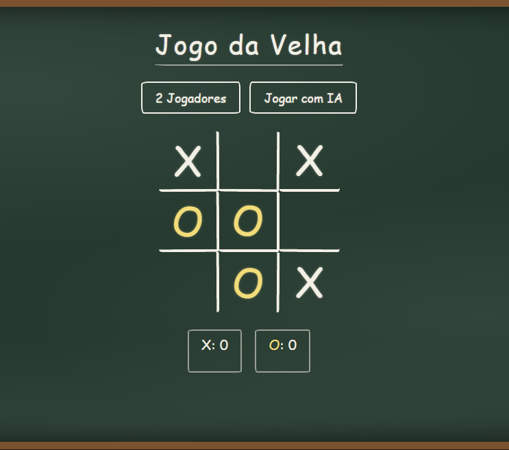

# Jogo da Velha

Jogo da velha para navegador, feito com HTML, CSS e JavaScript puro, sem frameworks nem bibliotecas. É possível jogar contra outra pessoa ou contra o computador. O visual imita um quadro-negro desenhado com giz.

Este projeto foi desenvolvido como prática dos conteúdos do curso de JavaScript do repositório [bootcamp-javascript](https://github.com/lucasnpiana/bootcamp-javascript).

## Preview



## Funcionalidades

- **Dois modos de jogo:** 2 jogadores no mesmo dispositivo ou contra o computador.
- **Computador com estratégia simples:** tenta vencer, bloqueia a vitória do adversário e, caso nenhuma das duas seja possível, joga em uma casa aleatória.
- **Início sorteado:** a cada rodada, quem começa é escolhido aleatoriamente.
- **Placar:** acumula as vitórias de X e O até o modo de jogo ser trocado.
- **Mensagem de resultado:** informa vitória ou empate e inicia a próxima rodada automaticamente.
- **Layout responsivo:** o tabuleiro se ajusta a telas pequenas.
- **Tema de quadro-negro:** linhas e peças com aparência de giz, animações discretas e suporte a `prefers-reduced-motion`.

## Como executar

Não há dependências nem etapa de instalação.

1. Clone o repositório ou baixe o `.zip`:
   ```bash
   git clone https://github.com/SEU-USUARIO/jogo-da-velha.git
   ```
2. Abra o arquivo `index.html` no navegador (duplo clique ou *Open with Live Server*, no VS Code).

> A fonte manuscrita é carregada do Google Fonts. Sem internet, o navegador usa uma fonte reserva do sistema e o jogo continua funcionando normalmente.

## Como jogar

1. Escolha **2 Jogadores** ou **Jogar com IA**.
2. Clique em uma casa vazia para colocar sua peça.
3. Vence quem completar uma linha, coluna ou diagonal.
4. Ao fim da rodada, o placar é atualizado e uma nova rodada começa sozinha.

Escolher um modo novamente no meio da partida reinicia o jogo e zera o placar.

## Estrutura do projeto

```
jogo-da-velha/
├── index.html    # Estrutura da página
├── styles.css    # Estilos (tema de giz no quadro-negro)
├── scripts.js    # Lógica do jogo
└── README.md
```

## Como funciona

- O tabuleiro é um array de 9 posições (`''`, `'x'` ou `'o'`), numeradas de 0 a 8 da esquerda para a direita e de cima para baixo.
- Uma lista com as 8 combinações vencedoras é comparada com o array a cada jogada.
- Cada peça é uma `div` criada em JavaScript com a classe `x` ou `o`, que o CSS usa para aplicar a cor e a animação.
- O computador testa cada casa vazia de forma temporária para descobrir se ela completa uma linha, para ele ou para o adversário.

## Conceitos de JavaScript praticados

| Conceito | Onde aparece no projeto |
|---|---|
| Variáveis com `const` e `let` | Elementos fixos da página (`const`) e estado da partida (`let`) |
| Funções e *arrow functions* | `jogar`, `venceu`, `terminar`, `jogadaIA` e os *callbacks* de eventos |
| Arrays e seus métodos | `fill`, `forEach`, `some`, `every`, `find`, `includes` e `push` |
| Objetos | Placar guardado em `{ x: 0, o: 0 }` |
| Estruturas condicionais | `if`, operador ternário e `??` (coalescência nula) |
| Manipulação do DOM | `querySelectorAll`, `getElementById`, `createElement`, `appendChild`, `classList`, `textContent` |
| Eventos | `addEventListener` com `click` nos botões e nas casas |
| Temporizadores | `setTimeout` e `clearTimeout` na jogada do computador e na mensagem de resultado |
| Números aleatórios | `Math.random` para sortear quem começa e a jogada aleatória do computador |
| Organização de código | Funções com responsabilidade única e comentários em padrão JSDoc |

<!-- Opcional: relacione cada linha da tabela com as aulas ou módulos do bootcamp,
     por exemplo "Arrays e seus métodos (Módulo X)". -->

## Possíveis melhorias

- Destaque visual da linha vencedora.
- Indicador de quem joga a vez.
- Níveis de dificuldade (fácil, médio e difícil).
- Placar salvo com `localStorage`.
- Constantes nomeadas para os tempos de espera (`500` ms e `1500` ms).

## Tecnologias


## Autor

Feito por **LUCAS NICKELE PIANA** como parte dos estudos do [bootcamp-javascript](https://github.com/lucasnpiana/bootcamp-javascript).

